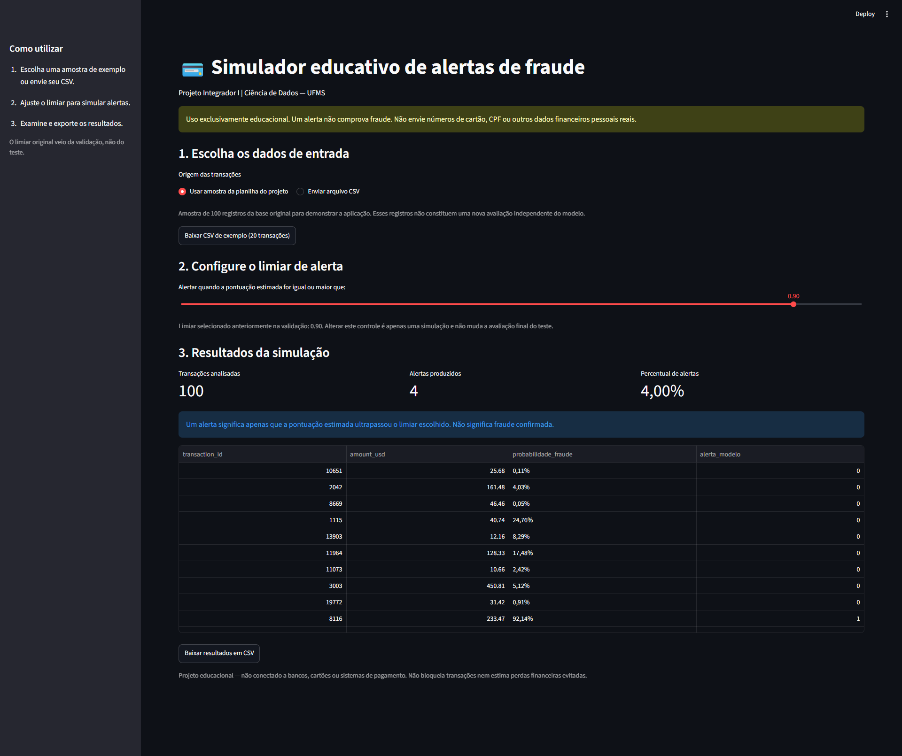

# Detecção de Fraudes em Cartões de Crédito com Machine Learning

**Projeto Integrador I — Ciência de Dados | UFMS Digital**

> Projeto educacional de análise de dados e classificação supervisionada para identificar **transações potencialmente fraudulentas**. Os alertas não comprovam fraude e não são utilizados para bloquear pagamentos reais.

**English summary:** Educational credit-card fraud detection project using Python, scikit-learn, Streamlit, Power BI and Docker. The application estimates a fraud score and simulates alert thresholds; it is not a production banking system.

## Visão geral

Este projeto reúne análise exploratória, treinamento e comparação de classificadores, avaliação separada em treino/validação/teste, dashboard no Power BI e aplicação interativa construída com Streamlit e executável com Docker.

A base estudada tem **20.000 transações**, **26 colunas**, sendo **339 registros rotulados como fraude** (**1,695%**). O conjunto foi dividido com estratificação em 60% treinamento, 20% validação e 20% teste.

## Demonstração visual

O dashboard foi desenvolvido no **Power BI** e contém três páginas. As imagens abaixo são capturas do relatório, não de uma aplicação hospedada.

### 1. Panorama das transações

Visão geral das 20.000 transações, frequência das fraudes e distribuição por diferentes características.


### 2. Desempenho do modelo

Avaliação do classificador no **conjunto de teste reservado** (4.000 registros), incluindo métricas e matriz de confusão.


### 3. Simulação de cenários

Comparação entre limiares de decisão, precisão, recall, F1-score e volume de alertas usando **dados de validação**. A página não representa uma segunda avaliação do teste.


### 4. Simulador interativo em Streamlit

A interface permite selecionar uma amostra da planilha, enviar um CSV, ajustar o limiar de alerta e exportar os resultados. Na captura abaixo, **100 transações de demonstração geraram 4 alertas** ao limiar de **0,90**. Esses números são apenas uma simulação com amostra da base e **não** devem ser confundidos com as métricas obtidas no conjunto de teste.



O aplicativo funciona **localmente** com Python ou Docker. Não há implantação pública, e nenhuma transação real é processada.

## Tecnologias

- **Python:** pandas, NumPy, matplotlib, scikit-learn, joblib
- **Machine Learning:** Regressão Logística, Random Forest e baseline (`DummyClassifier`)
- **Visualização:** Power BI e gráficos Python
- **Aplicação:** Streamlit
- **Ambiente:** Docker e Docker Compose
- **Versionamento:** Git e GitHub

## Resultados documentados

### Comparação na validação

| Modelo | Average Precision (AP) |
| --- | ---: |
| Regressão Logística | **0,2725** |
| Random Forest | 0,1457 |
| Baseline | 0,0170 |

A Regressão Logística foi selecionada pela AP na validação. O limiar de alerta foi escolhido separadamente, maximizando o F1-score nos cenários testados na **validação**. O conjunto de teste não foi utilizado para essa escolha.

### Avaliação final — conjunto de teste (4.000 transações)

| Métrica | Resultado |
| --- | ---: |
| Acurácia | **96,63%** |
| Precisão | **26,24%** |
| Recall | **54,41%** |
| F1-score | **35,41%** |
| Average Precision (AP) | **0,3727** |

**Matriz de confusão:** VN = 3.828; FP = 104; FN = 31; VP = 37. O classificador identificou **37 das 68 fraudes reais** no teste e gerou **104 alertas falsos**. A acurácia, isoladamente, não é uma boa medida nesse conjunto desbalanceado: prever todas as transações como legítimas já produziria aproximadamente **98,31% de acurácia**, mas não detectaria nenhuma fraude.

> Os números acima correspondem à execução documentada do projeto. Reproduções em outros ambientes devem usar as mesmas versões e o mesmo conjunto de dados para permitir comparação.

## Organização do projeto

```text
.
├── app.py
├── Dockerfile
├── compose.yaml
├── requirements.txt
├── requirements-docker.txt
├── data/raw/                   # base original (licença CC0, conforme fonte)
├── src/                        # auditoria, EDA, treinamento e avaliação
├── models/                     # pipeline salvo (.joblib)
├── reports/                    # métricas, cenários e previsões
│   └── figures/               # gráficos e capturas autorizadas
├── powerbi/                    # dashboard .pbix (quando incluído)
```

## Fluxo de análise e reprodução

Os scripts ficam na pasta `src/` e devem ser executados a partir da **raiz do projeto**:

| Ordem | Script | Objetivo |
| --- | --- | --- |
| 1 | `01_auditoria_base.py` | Verificar estrutura, valores ausentes, identificadores e desbalanceamento |
| 2 | `03_analise_exploratoria.py` | Produzir tabelas e gráficos para compreender os dados |
| 3 | `02_treinar_modelos.py` | Separar treino/validação/teste, preparar os atributos, comparar classificadores e salvar o modelo |
| 4 | `04_cenarios_limiar.py` | Testar limiares na validação e registrar a escolha pelo F1-score |
| 5 | `05_avaliacao_final.py` | Avaliar o modelo escolhido **uma vez** no teste reservado e gerar métricas e gráficos |

Para reproduzir o treinamento, depois de instalar as dependências e a partir da pasta principal:

```powershell
.\.venv\Scripts\python.exe src/01_auditoria_base.py
.\.venv\Scripts\python.exe src/03_analise_exploratoria.py
.\.venv\Scripts\python.exe src/02_treinar_modelos.py
.\.venv\Scripts\python.exe src/04_cenarios_limiar.py
.\.venv\Scripts\python.exe src/05_avaliacao_final.py
```

**Atenção:** a reprodução pode sobrescrever o modelo, os relatórios e os resultados versionados. Faça uma cópia ou utilize uma branch separada para experimentos. O teste deve permanecer reservado para a avaliação final, não para escolher algoritmos ou limiares.

## Executar localmente com Python

Na pasta do projeto, crie um ambiente virtual e instale as dependências:

```powershell
py -m venv .venv
.\.venv\Scripts\python.exe -m pip install -r requirements-docker.txt
.\.venv\Scripts\python.exe -m streamlit run app.py
```

Acesse `http://localhost:8501`.

## Executar com Docker

É necessário ter Docker Desktop/Engine em execução. A configuração atual é para **uso local**: o `compose.yaml` compartilha a pasta `data/raw/` em modo somente leitura e publica a aplicação apenas no endereço de loopback do computador.

```powershell
docker compose up --build -d
docker compose ps
```

Acesse **http://localhost:8502**. Para encerrar:

```powershell
docker compose down
```

**Atenção:** a imagem Docker não incorpora a planilha `data/raw/`; a montagem local é feita pelo Docker Compose. Para hospedagem pública será preciso adaptar a configuração, definir políticas para arquivos enviados e validar o tratamento dos dados.

## Dashboard Power BI

O relatório tem três páginas: (1) panorama da base completa, (2) desempenho do modelo no teste e (3) simulação de limiares na validação. Esses conjuntos são distintos e não devem ser somados ou confundidos.

## Origem e licença dos dados

Dataset de referência: **Credit Card Fraud Detection 2026**, publicado no Kaggle por **Udit Jain**:

https://www.kaggle.com/datasets/uditjain13/credit-card-fraud-detection-2026

Licença informada na fonte: **CC0 1.0 — Public Domain**: https://creativecommons.org/publicdomain/zero/1.0/

A identificação da origem é mantida como prática acadêmica, embora a CC0 não exija atribuição. A licença dos **dados** não determina automaticamente a licença do **código, imagens, dashboard ou demais contribuições** do projeto.

## Limitações e uso responsável

- Estudo educacional: nenhuma previsão constitui confirmação de fraude.
- A amostra de demonstração do Streamlit não representa uma nova avaliação independente.
- As probabilidades são estimativas do modelo e não devem ser tratadas como chances calibradas sem análise adicional.
- A base é desbalanceada; falsos positivos e falsos negativos têm impactos distintos.
- Recursos/atributos disponíveis apenas após uma transação não devem entrar em um modelo de decisão em tempo real sem auditoria do momento da informação.
- Não envie números reais de cartões, documentos pessoais ou transações privadas à aplicação.
- **Não carregue arquivos `.joblib` não confiáveis**: a desserialização desse formato pode executar código.
- Somar valores rotulados como fraude não comprova dinheiro recuperado ou prejuízo evitado.

## Autoria e contribuições

Este projeto foi desenvolvido no contexto da disciplina **Projeto Integrador I — Ciência de Dados, UFMS Digital**.

### Equipe do projeto acadêmico

- **Vinícius Ilário Cordeiro**
- **Rebeca Dias Pegollo**
- **Rubens Lima Araujo**
- **Tiago Moreira Andrade Salviano**

**Contribuições coletivas da equipe:** escolha da base de dados, planejamento da ação e definição do objetivo do projeto.

**Implementação técnica realizada por Vinícius Ilário Cordeiro:** preparação e análise exploratória dos dados em Python; treinamento, comparação e avaliação dos modelos de Machine Learning; construção dos dashboards em Power BI; desenvolvimento do simulador Streamlit; configuração de execução com Docker; organização do repositório, versionamento no GitHub e documentação técnica.

A distinção acima identifica as etapas informadas como coletivas e individuais, sem atribuir a concepção acadêmica do projeto exclusivamente ao responsável pela implementação técnica.

## Próximas melhorias

- Revisar origem temporal e disponibilidade das variáveis usadas pelo modelo.
- Adicionar testes automatizados e pipeline de integração contínua.
- Preparar uma configuração de hospedagem com controles adequados de privacidade e segurança, caso seja necessária no futuro.
- Registrar a apresentação à comunidade e o feedback da ação de extensão.

---

## English — project abstract

A reproducible educational workflow to study **credit-card fraud detection** on an imbalanced dataset. A logistic regression classifier achieved **26.24% precision**, **54.41% recall**, **35.41% F1-score** and **0.3727 Average Precision** on a held-out test set. The repository includes Python scripts, a Power BI report, a Streamlit demo and a local Docker configuration. Predictions are **alerts for review, not confirmed frauds**.
